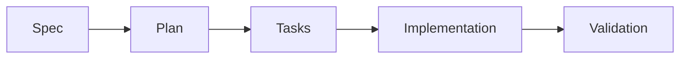

# Spec-Driven Development (SDD) — Mangá Atlas

O **Spec-Driven Development (SDD)** é a metodologia que rege o ciclo de vida de desenvolvimento do projeto Mangá Atlas.

Nenhuma funcionalidade de médio ou grande porte é implementada sem especificação e planejamento prévios.

---

## 1. Fluxo Oficial



1. **Spec (`spec.md`):** define o _o quê_ e o _porquê_. Documenta objetivos, requisitos funcionais e não-funcionais, critérios de aceite e o que está fora do escopo.
2. **Plan (`plan.md`):** define o _como_. Estrutura a abordagem técnica, módulos afetados, decisões arquiteturais (ADRs), estratégias de teste e mitigação de riscos.
3. **Tasks (`tasks.md`):** lista ordenada de tarefas acionáveis e rastreáveis com caixas de seleção (`- [ ]`), determinando a ordem lógica de execução.
4. **Implementation:** execução do código guiada estritamente pelas especificações e convenções do projeto.
5. **Validation:** execução de Prettier, ESLint, testes com Vitest, cobertura e build de produção (`npm run check`).

---

## 2. Localização das Especificações

As especificações ficam centralizadas em:

```text
docs/specs/
├── 001-mvp/
│   ├── spec.md
│   ├── plan.md
│   └── tasks.md
```

Novos ciclos ou épicos recebem pastas numeradas sequencialmente (ex.: `002-data-sync/`, `003-price-charts/`).

---

## 3. Modelos de Documentos (Templates)

Para iniciar uma nova especificação, utilize os modelos disponíveis em `docs/sdd/templates/`:

- [`spec.template.md`](templates/spec.template.md)
- [`plan.template.md`](templates/plan.template.md)
- [`tasks.template.md`](templates/tasks.template.md)
